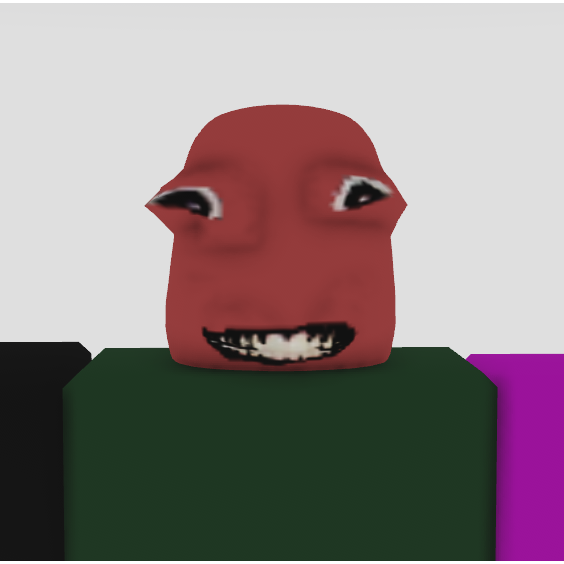

  

# FathomMapper
Created by Akamiechie
## How to Use
Open the executable file to start the program. Once you start mapping you should see some info text next to your cursor. There are 2 sections:
* the first section contains diagnostics about your current mapping session
* the second section contains the hotkeys you can use while mapping
keep in mind that in order for it to work roblox must be maximized and it must be running on your main monitor
## Tips
* avoid using either variation of the lantern, as colors that are not monochrome can cause interference with the program and result in a less accurate map
* go to settings > accessibility > and turn on corner box for more accurate mapping
* put this program in a designated directory for better ease of access to the program and the maps it creates
* remember that once a map is saved nothing can be added to it, so make sure that when you save a map you are completely done mapping the area
## Saving Maps
You can save maps by pressing F2. Once you save a map the program will look for a folder called "FathomMaps". If it cannot find one it will make one. Once that happens it will create a map as an HTML file named like this:
* the first part of the name is "CoordinateMap"
* the second part is in YYYY-MM-DD format
* the third part of the name is in HH-MM-SS format
* if there is somehow already a map with the exact same name it will add an extra number at the end
* the last section is the file type, which is HTML

Example file name: `CoordinateMap_2026-11-07_12-00-00.html`
Along with your path and the pins you have created, the program will save the start and end points, plus the points where you paused and unpaused the mapping process
## Opening Maps
The program automatically opens the map once you press F2 to save it. The map should open in your browser as a tab. If you want to view it again later the maps are stored as HTML files inside a folder called "FathomMaps" in the same directory as the program.
## Navigating Maps
Maps can be viewed on mobile and PC. You can zoom and pan around the map, and on PC press 0 on your keyboard to fit the map to your screen. In the top left you will see a max jump box where you can input a number. This determines how far a line can stretch before it is excluded from view. Numbers too large will allow false points, but numbers too small will remove some of the map. A number around 6-25 is recommended. On the right of that is some info about how many points are visible and how many pinpoints are on the map. After that are the zoom in (+), zoom out (-), and Fit map buttons, which are meant for mobile. On PC you can use the scroll wheel and the 0 key.
## License
FathomMapper is licensed under the GNU General Public License version 2.0. See `LICENSE.txt` for the complete license and `NOTICE.txt` for copyright information. Third-party software included in FathomMapper is listed in `THIRD-PARTY-LICENSES.txt`, and `SOURCE-CODE-AVAILABILITY.txt` explains where to find the corresponding source code.

### \- Akamiechie ❤️
